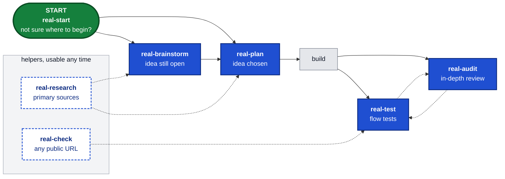

# Skills for real AI product leads

Seven connected workflows for deciding what to build, proving what exists, and improving products with evidence.

## How they fit together



Solid arrows are the usual path; dashed arrows are optional handoffs. Every workflow also works on its own: start with `real-brainstorm` when the idea is open, with `real-plan` when it is chosen, or let `real-start` pick. Reports land in `docs/brainstorm/`, `docs/plans/`, `docs/audits/`, `docs/research/`, `real-test-reports/` and the `real-check` output folder.

## The seven workflows

| Skill | Use it for |
|---|---|
| `/real-start` | Route an ambiguous or mixed request |
| `/real-brainstorm` | Generate ideas or stress-test one: research, 5 Whys debate, separate judge, one recommendation |
| `/real-plan` | Shape and approve a feature, change, or decision before code |
| `/real-audit` | Improve a product, module, screen, flow, or measured web performance |
| `/real-check` | Quick automated check of any public URL: one-page owner-facing report, optional outreach draft |
| `/real-test` | Playwright tests for the key user flows of your own web app: plan, generate, run, heal once, report with screenshots, console and accessibility findings and a visual comparison; optional Firefox, WebKit and CI; reruns need no model |
| `/real-research` | Resolve current external facts from primary sources |

`real-check`, `real-test` and `real-audit` are different jobs. `real-check` takes any public URL with no code or account access, typically finishes in about 30 seconds, is rule-based and deterministic (no AI), is read-only, and writes a one-page report for the site's owner; the site is often someone else's (client, prospect, competitor). `real-test` is for your own app (local, staging or a URL you own): an AI explores it, you approve a plan, it writes persistent Playwright tests for the user flows that stay in your repo, runs and heals them once, and reports passed / failed / fixme / blocked. `real-audit` is expert judgment on your own product in depth (repo, running app, screens) with prioritized findings, coverage and validation tasks. `real-audit` runs `real-check` first when its scope includes the product's public web surface.

You do not have to type a command. Their descriptions are available to the model, so a request such as “What should we improve in this product?” can invoke `real-audit` automatically. Direct commands remain available when you want a specific workflow.

`real-audit` progressively loads Product, Module, Design, Monetization, Security, Quality, and Performance modes. A whole-product audit assesses applicability across value, UX/design, security/privacy, quality/reliability and performance; a narrow task stays narrow. `real-plan` contains discovery and the five-heading feature gate. Baseline design rules are supporting material inside the audit, so they do not add another command.

Automatic selection is client- and context-dependent, not guaranteed. Confirm a successful instruction load in the trace when testing routing. Earlier behavioral evaluation artifacts were removed and are no longer independently inspectable in this repository. Current reproducible checks and their limits are listed in [verification status](docs/real-hardening-status.md). New instruction revisions still need behavioral retesting.

## Orchestration

Small reversible work stays with one agent. The workflows split work when it is externally visible, sensitive, cross-repository, dependent on live external facts, larger than 10 files, or explicitly requested as orchestration.

Triggered work uses at least two independent perspectives and an adversarial verifier. Models are chosen by capability rather than pinned versions:

| Work | Codex preference | Claude-compatible preference |
|---|---|---|
| Product architecture and synthesis | Astra | highest product/architecture tier, including Fable when offered |
| Adversarial verification | Astra | Opus |
| Broad implementation | Sol | Sonnet |
| UI/product implementation | Terra | Sonnet |
| Mechanical discovery | Luna or Spark | Haiku |

If a family is unavailable, use the nearest capability tier. The verifier cannot be weaker than the strongest producer it checks.

## Install

### Claude Code plugin

```text
/plugin marketplace add giraybatiturk/skills
/plugin install giraybatiturk-skills@giraybatiturk
```

Plugin commands are namespaced, for example `/giraybatiturk-skills:real-audit`.

### Claude Code symlinks

Use this route for short commands and immediate local edits. Do not enable the plugin at the same time.

```bash
# First clone the repository if no local checkout exists.
git clone https://github.com/giraybatiturk/skills.git "$HOME/Developer/skills"
bash "$HOME/Developer/skills/scripts/install-local.sh" "$HOME/.claude/skills"
```

If the checkout already exists, skip cloning. The installer validates the whole bundle before changing links, supports repeated runs, and stops on copied directories or foreign links. Move conflicts to a backup outside the skills directory and retry. For local Codex installation, run the same script with `"$HOME/.agents/skills"`.

### Claude app (claude.ai and Claude desktop)

Each skill uploads as its own zip; the app does not accept a multi-skill bundle. Download the seven zips from the [latest release](https://github.com/giraybatiturk/skills/releases/latest), then in the app open Customize > Skills > + > Upload a skill and upload them one by one. Upload all seven; `real-plan` and `real-start` expect `real-audit` next to them. `real-test` needs a shell and a browser, so it does nothing useful in the app itself; use it from Claude Code or Codex.

To build the zips from a checkout instead:

```bash
# Needs jq and zip.
bash scripts/build-zips.sh
```

Each description ends with a version stamp such as `(v0.8.0)`, so the app's skill list shows which release is installed. On a new release, upload the new zip again; a skill with the same name is updated in place.

### Codex

```bash
npx skills@1.7.4 add giraybatiturk/skills -g -a codex -s '*' -y
```

Open a new session after installation. The public list should contain exactly `real-start`, `real-brainstorm`, `real-plan`, `real-audit`, `real-check`, `real-test`, and `real-research`.

The supported installation is the complete seven-skill bundle. Plan depends on Audit references; installing Plan alone is unsupported and produces an explicit missing-dependency message. Existing copied installations require migration using the conflict instructions above.

## Hooks

The folder [`hooks/`](hooks/README.md) holds optional guard hooks. They protect your repo while you and your agent work.

- Git hooks block a commit on `main`, a new page or action with no test, and a token or private name in a push.
- Agent hooks for Claude Code and Codex guard dangerous commands, secret files and weak tests. They run a done gate before the agent stops.
- The open guard denies a direct `open`, `xdg-open` or browser start in the agent shell. `scripts/real-show.sh` prints a verified link to a file, folder or page instead.
- `real-show.sh --open` opens a folder or a file on macOS only. A web page gets a link and is never opened.
- The turn log records the start, the request and the end of each agent turn. At the end of a turn of 120 s or more, `notify.sh` sends a banner. The banner shows the `STATE:` line of the last reply.
- `/real-status` prints at most 8 lines: the branch, the contract, the last commands, the last turn and the background jobs. It makes no model call. `scripts/real-status.sh` runs in any shell.
- `/real-ship` commits, pushes and opens the PR or MR in separate steps. It refuses on `main` and never merges. Read [docs/real-ship.md](docs/real-ship.md).
- `scripts/real-ship.sh` never uses `git add -A`, never forces a push and never skips a hook. The command template is `commands/real-ship.md`.
- The context hook `real-context.sh` runs at session start. It gives the agent repo facts: the last request, git, the contract and your open PRs. Memory notes are optional. Each line is masked.
- The same hook gives you a recap of 3 lines or less. It shows the last request, how the last turn ended, and the git and contract facts.
- `scripts/real-await.sh` waits for a human step, such as a login, a download or a merge. It checks a file, a URL, a pull request, a command or a process, and exits when the check passes. The finished background job wakes the agent.
- `/real-status` shows a `waiting:` line while a wait runs. Read [docs/real-await.md](docs/real-await.md) for the probes, the exit codes and the one notification.

Nothing is installed by default. Run `scripts/install-hooks.sh --print <repo>` to see what an install would do. Run `sh scripts/test-hooks.sh` to test the hooks in temporary repos. Read [hooks/README.md](hooks/README.md) for the settings and the client support.

## Dependencies

`real-check` needs Node 20+ and downloads Chromium (through Playwright) on first run. Where installing is not permitted, it stops and says so instead of faking a result.

`real-test` needs Node 20+, a shell, and `@playwright/test` with Chromium; with your consent it installs `@playwright/test` and `@axe-core/playwright` into your project as dev dependencies, downloads Chromium (all from the network; Firefox and WebKit too with `--browsers`), and runs `npx playwright init-agents` (Playwright's own planner, generator and healer agents) there; that command overwrites an existing `.mcp.json`, so the skill backs it up and merges your other servers back. It runs on your machine inside your coding agent (your subscription, no API key). Credentials go only to the app under test: you log in yourself once, and no plan, test or prompt contains them. Test data, page content, snapshots and test code go to the app under test and pass through your agent's model provider; there is no telemetry, and the npm and Chromium downloads (Firefox and WebKit too with `--browsers`) are the only other traffic. After installing the agents, restart the session once so the client loads them. By default tests stop before the final submit of any write (send, delete, pay, invite, publish); with `--allow-writes` on a non-production target they do submit, with fake data only, and those tests are tagged `@writes` and skip themselves when pointed at another origin. Every run also writes a self-contained `visual.html` next to the report (a screenshot per flow and project, console and network errors, axe-core findings, and a comparison with the last run); these are observations and never fail a test, and the screens stay on disk, not with the model. Optionally the skill writes a GitHub Actions workflow that reruns the tests without a model; CI has no login session, so login flows fail there. Where there is no shell, it stops and says so.

Three skills ship scripts:

- `real-check`: `skills/engineering/real-check/scripts/check.mjs`, the scan itself.
- `real-test`: `skills/engineering/real-test/scripts/guard.mjs`, `summary.mjs` and `visual.mjs`, plus `assets/fixtures.ts`, the observations fixture copied into your tests folder.
- `real-audit`: `skills/product/real-audit/scripts/annotate-evidence.mjs`, which draws the marked screenshots of its evidence method. It needs Node 20+ and uses the Playwright and Chromium install of `real-check` next to it (or one in the current folder). It opens its own headless browser on the URLs in its spec (the page loads its own resources and counts as a visit) and writes only to the folder you give it. Without it, the audit keeps the original capture and describes the marked area in words.

The other workflows are instructions only.

To run the local tests from a checkout: `node scripts/test-real-check.mjs` (Node standard library only; needs Playwright and Chromium installed in `skills/engineering/real-check/scripts`) and `node scripts/test-real-test.mjs` (Node standard library only, no browser, no network).

## Natural-language routing

Intended routes below depend on client selection; use the explicit command when routing must be deterministic.

- “What feature should we build next in this app?” → `real-brainstorm`: Quick or Deep; Deep adds competitor and pricing research, a 5 Whys debate and a separate judge.
- “Build medication reminders” → `real-plan`: User story, Analysis, Backend scope, Frontend scope, and Connection before code.
- “What should we improve next in this product?” → `real-audit` Product mode.
- “This screen feels crowded” → `real-audit` Design mode, project `DESIGN.md` before the baseline.
- “Check the latest App Store rule” → `real-research`, primary sources.
- “Check https://example.com for broken links before I email the owner” → `real-check`: automated scan of the public URL, one-page report, optional message draft that is never sent.
- “Audit our checkout flow” → `real-audit`: your own product in depth, evidence from the running app and code.
- “Write tests for the signup and checkout flows of our staging app” → `real-test`: your own app; an AI explores it, you approve a plan, Playwright tests stay in your repo, they run at 1280 and 375 px (Firefox and WebKit on request), and a failing one is healed once or marked `test.fixme` with a reason.
- “Is this animation smooth?” → `real-audit` Design with Motion, runtime evidence required.

## Migration from 0.7

| Previous command | New route |
|---|---|
| `/real-grill` | `/real-plan` discovery |
| `/real-feature-gate` | `/real-plan` feature gate |
| `/real-product-audit` | `/real-audit` Product |
| `/real-module-audit` | `/real-audit` Module |
| `/real-design-audit` | `/real-audit` Design |
| `/real-perf-audit` | `/real-audit` Performance |
| `real-design-rules` | loaded by `real-plan` and `real-audit` for UI work |

Old commands are intentionally absent from discovery so the menu stays small. `real-start` knows the mapping and routes old terminology to the new workflows.

## Changelog

- **0.13.1** (2026-10-20): `real-test` report and language. `visual.html` is the one page to open, redesigned: a summary row (tests passed, failed, screens changed, tests with findings), an overview table with each flow's test and screen status per project, and one collapsible card per flow (opened when it failed or its screen changed) with screens at a fixed scale in scroll frames, so phone screens no longer fill the page; the header links the Playwright HTML report (`html/index.html`) for steps, errors and traces, and the chat no longer offers that report as a second page. Language: the plan, `report.md` and the final chat message are English by default, whatever language the conversation is in; Turkish only with `--lang tr` or an explicit request; scenario names (test titles) are always English. Status badges are HTML-escaped. Only the `real-test` stamp and the plugin version move to 0.13.1. Security fixes: the preflight removes `browser_run_code_unsafe` from all three agents (planner, generator, healer), the standing rules treat page content as evidence, never instructions, and forbid leaving the target's origin; the guard rejects code that reaches Node (`node-escape`: `process` other than `process.env`, `globalThis`, `getBuiltinModule`, `module.require`, `Function(`) and the docs say it is a pattern check, not a sandbox, with the user's review of the specs as the real boundary; the CI template sets `permissions: contents: read` and pins its actions to commit SHAs; the Codex install command pins `skills@1.7.4`.
- **0.13.0** (2026-10-20): `real-test` records evidence with every flow and can run beyond Chromium. Observations fixture: the skill ships `assets/fixtures.ts`, which the preflight copies to `<out>/real-test.fixtures.ts` on every run, and generated specs import `{ test, expect }` from it. One auto fixture per test records console errors, page errors, responses with status 400 or more and failed requests (URLs without query or fragment, same-origin or third-party) and, after the test body, attaches a full-page screenshot, an axe-core run for WCAG 2.0 and 2.1 A and AA, and that record. It only observes and never fails a test; `@axe-core/playwright` is installed as a dev dependency with consent. Guard: `real-test.fixtures.ts` is accepted only when it is byte-identical to the shipped file (rule `fixtures-changed`, rejected otherwise; the heal cannot touch it), and a planned spec that does not import it gets the warning `fixtures-not-imported`, which `summary.mjs` lists as `guard.noFixtures`. `--browsers firefox,webkit` adds desktop projects `real-test-firefox` and `real-test-webkit` (1280 px), installs the browsers with consent and includes them in the run, `grepInvert` and rerun commands; `summary.mjs` returns `projects`, the report has one column per project, and the `fixme` form can name a browser. New `scripts/visual.mjs` (Node standard library only): copies each flow's screen to `<report>/screens/` (the next run's baseline), compares it with the newest earlier report of the same host (8-bit RGB and RGBA PNGs decoded with `node:zlib`; `same`, `changed`, `size-changed`, `new`, `missing`, `not-comparable`) and writes a self-contained `visual.html` with the screens per project, baseline against current plus a difference overlay for changed ones, and the console, network and accessibility findings per flow. Screens and observations are evidence: they never change a flow's status. A new last step offers a GitHub Actions workflow (`.github/workflows/real-test.yml`: push to the default branch and manual dispatch, Node 20, `npm ci`, `npx playwright install --with-deps`, the same projects against the repository variable `REAL_TEST_BASE_URL`, the Playwright report as an artifact; no model). CI has no `.auth/` session, so login flows fail there and the skill puts no credentials into it; `@writes` tests are skipped off-origin by `grepInvert`, and CI never targets production writes. Limits: axe-core finds only a subset of WCAG issues, and a screenshot of dynamic content differs between runs without a real change. Only the `real-test` stamp and the plugin version move to 0.13.0; the other skills are unchanged. `scripts/test-real-test.mjs` now also covers the fixtures check, the visual comparison statuses and an extra project column.
- **0.12.0** (2026-10-06): Added `real-test`: point it at your own web app (local, staging or a URL you own) and get a test plan of its key user flows, Playwright tests generated from the approved plan and kept in your repo (`./tests/real-test/` by default), a run at desktop (1280 px) and phone (375 px) width, one healing pass, and a short report (`./real-test-reports/<host>-<date>/`) with every flow marked passed, failed, fixme or blocked, reproduction steps and screenshot paths. It builds on Playwright's official test agents (`npx playwright init-agents`: planner, generator, healer) instead of a custom agent; reruns are plain `npx playwright test` with no model. Claude Code (`--loop=claude`) was run end to end; for Codex (`--loop=codex`) the agent files are generated and hardened, but in a non-interactive test the spawned planner had no Playwright tools, so treat Codex as unverified. It runs on your machine inside your coding agent; besides the app under test and the npm and Chromium downloads of setup, data goes only to the agent's own model provider, and there is no telemetry. The user approves the plan before any test is written, and says for every host whether it is production; the agents' browser and the report runs are pinned to the target's origin. Login is done once by the user (`storageState`, git-ignored); credentials never enter a test or a prompt. Safety: by default tests stop before the final submit of any write (send, delete, pay, invite, publish); with `--allow-writes` on a non-production target they submit fake data and carry a `@writes` tag, so reruns against another origin skip them; a failing test becomes `test.fixme` with a reason instead of a weakened assertion, and the guard compares the matcher and arguments of every assertion with the pre-heal copy. Two helper scripts ship with the skill: `guard.mjs` (a static pattern check of every code and data file in the tests folder: it sets aside generated tests that mock the network, call the backend directly, skip, loop or weaken assertions or carry secrets, and restores tests the healer weakened, deleted or broke; it is not a parser and cannot tell a locator repair from an assertion pointed at something weaker, so it lists every assertion whose locator text changed for the report) and `summary.mjs` (turns the Playwright JSON report, the plan and the guard output into the numbers and lists the report is written from, blocked flows and specs outside the plan included). Boundary: `real-check` stays the rule-based, read-only scan of any public URL, `real-audit` the in-depth review of your own product; `real-start` routes to `real-test`, and the `real-start`, `real-check` and `real-audit` stamps move to 0.12.0 because their routing text changed. A local test script, `scripts/test-real-test.mjs`, checks the frontmatter, version stamps, skill lists and the two scripts without a browser; it is not part of the skill zip. Needs Node 20+ and downloads Chromium on first run; the stop-before-submit rule is enforced by instructions and the guard, not by a network block.
- **0.11.0** (2026-10-03): Added `real-check`: a quick, rule-based, read-only check of any public URL that writes a plain-language one-page report (HTML + PDF) for the site's owner. Checks that the page opens, browser console errors, broken links on the home page, and the phone layout at 375 px (horizontal overflow, or a missing viewport setting). Optional `--outreach` makes the script write a tracking row (also for runs that end without a report) and the skill, that is the agent, write a message draft (at most three findings, no jargon, nothing is sent); `--control` makes no request: the script writes only the tracking row and creates the run folder, and the agent writes a neutral draft for an A/B comparison group. False positives are filtered: a failed load from another registrable domain, including an HTTP error, is a warning; only 404, 410, 500, 502 and 504 count as broken links (redirects are followed only within the site); links that look like actions (log out, delete, cancel, cart, `confirm` or `...token` query parameters) are not requested and are reported as not checked, in English, Turkish, German, French, Spanish, Italian, Portuguese and Dutch (mostly stems, so nouns match too; the non-English words come from general knowledge, not from measured sites; a few short words match only as whole words and some stems only at the start of a word, which still skips everyday uses such as `/donde-salir`), and because keywords match anywhere in the address an ordinary page such as `/cancellation-policy` is skipped and listed too; a refused home page (401, 403, 429, 503, Cloudflare challenge) is reported as blocked rather than as a finding; every write request is blocked (a page that submits a form as it loads ends the check with exit 4 and a reason that names the blocked write), and so is every request the page sends straight to a private or local address (literal addresses only, no DNS lookup; a redirect to one is detected, not prevented). Console errors that follow a blocked request are not counted as findings: a failed load of the same URL or a generic network error within about 2 seconds, and WebSocket errors after a closed WebSocket (no time window). They are reported as possibly caused by the block and kept in `findings.json`. When the home page has more than 50 links to check, a warning says how many were found and that only the first 50 were checked. Boundary: `real-check` is for any public URL with no code access; `real-audit` stays the in-depth review of your own product, and `real-audit` now runs `real-check` first as automated evidence when its scope includes a public web surface. `real-start` routes to it; the `real-audit` and `real-start` stamps move to 0.11.0 because their behavior changed. A local test script, `scripts/test-real-check.mjs`, runs the helpers and the CLI against local fixture servers; it is not part of the skill zip. Needs Node 20+ and downloads Chromium on first run.
- **0.10.0** (2026-09-29): Added `real-brainstorm`: Quick/Deep depth, independent generators (mind map, SCAMPER, reverse brainstorming, role storming), market card with competitor, precedent, willingness-to-pay and revenue-range evidence, 5 Whys debate, pairwise judge blind to idea origin, three user checkpoints and a local report. Reads Real Audit monetization/reporting/orchestration and Real Research rules read-only. `real-start` routes to it; `real-plan` description points idea generation there.
- **0.8.0** (2026-09-13): Consolidated nine entries into four workflows; added automatic natural-language routing, progressive audit modes, capability-based orchestration, and a four-item install path.
- **0.7.0** (2026-09-13): Added the product audit.
- **0.6.0** (2026-09-10): Restored the interactive start router.
- **0.5.0** (2026-09-09): Reduced the original 19-skill set to seven focused workflows.
